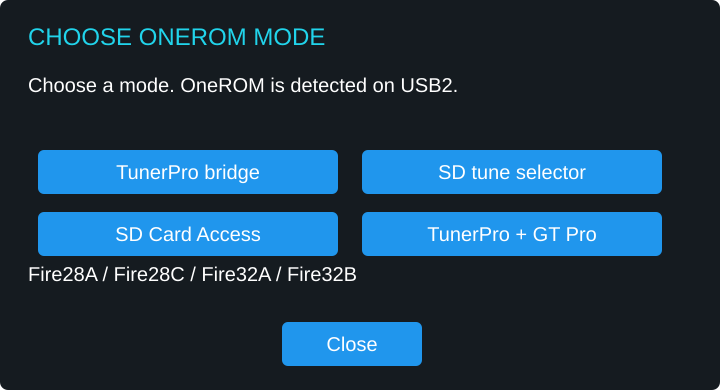
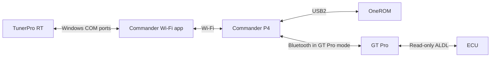

# Commander Wi-Fi menu guide

The shared menu illustrations come from the wired Commander documentation. Status values and filenames are examples. The connection diagram below shows the Wi-Fi bridge.

*OneROM mode chooser in the Wi-Fi build, recreated from the firmware layout.*

## Program and verify OneROM in the Rapid Fire OneROM app

1. Keep OneROM disconnected from the ECU. Connect it directly to your computer and open the Rapid Fire OneROM app.
2. The Rapid Fire OneROM app automatically detects and selects your OneROM board and sets the intended ROM size. Select the **NORMAL DT** firmware profile, then program the tune BIN you want to start with.
3. Read the programmed ROM back in the app and confirm that it matches the intended BIN byte for byte. If you plan to use the SD Tune Selector, put a copy of that verified BIN at the root of the FAT32 microSD card.
4. Once the readback matches, disconnect OneROM from the computer and plug it into Commander's **USB2** port. Open the Commander mode you want to use and confirm that it detects the expected board and ROM size.

## OneROM modes

| Mode | Use |
|---|---|
| TunerPro bridge | Laptop on Commander Wi-Fi, OneROM on USB2. Select the Windows COM port mapped to OneROM emulation. |
| TunerPro + GT Pro | Separate Windows COM ports for OneROM emulation and read-only GT Pro ADX logging. |
| SD tune selector | Browse and load a matching BIN from the FAT32 microSD card onto OneROM with the engine off. |
| SD Card Access | Expose the P4’s SD card as a removable drive through USB3. The tune selector and serial bridge pause while this mode owns the card. |

### TunerPro bridge

Connect OneROM to **USB2** and power the P4 through **USB3**. Open **OneROM → TunerPro bridge**, wait for **OneROM ready on USB2**, join the P4’s Wi-Fi in Windows and select **Connect** in the Commander Wi-Fi app. Choose the COM port mapped to OneROM emulation in TunerPro RT. Start with a readback before attempting a write. See [COM port mapping](README.md#connect-the-laptop).

With a compatible OneROM setup and emulation enabled, TunerPro RT can send live calibration edits while the engine is running. TunerPro RT sends the editor update through Commander's bridge, and OneROM serves the updated data to the ECU. Perform live edits while the vehicle is stationary. See the [TunerPro RT emulation guide](https://www.tunerpro.net/WebHelp/source/emulation.htm).

### TunerPro + GT Pro ADX logging

Commander Wi-Fi passes read-only ALDL requests and replies between TunerPro RT and the GT Pro. Load the ADX in TunerPro RT so it can decode the ECU replies.

1. Connect OneROM to **USB2** and power the P4 through **USB3**. Choose **OneROM → TunerPro + GT Pro**, join the P4 network in Windows and connect the Commander Wi-Fi app.
2. In **Settings → OBDX devices**, select the GT Pro and tap **Connect selected**. Wait for **GT Pro ALDL acquisition ready** on the OneROM screen.
3. In TunerPro RT, use the **OneROM emulation** COM port for Ostrich. Under **Preferences → Data Acq./Emulation**, choose **Standard Serial** and the separate **GT Pro ALDL acquisition** COM port. Use the COM numbers assigned by your Windows serial port provider.
4. Stop acquisition if it is running. Choose **Acquisition → Load Definition File**, load the ADX for your ECU and calibration, then start acquisition.

After a verified SD tune load, Commander can identify OSE $11P V104 or $12P V112. Use that recommendation to choose the matching ADX variant in TunerPro RT. For a factory or unknown profile, choose the definition for the installed ECU and calibration.

See [Wi-Fi bench results](README.md#bench-results) for the confirmed tests. Live GT Pro telemetry with an ECU connected remains to be verified on the Wi-Fi build.

### SD Tune Selector

The SD Tune Selector loads the selected BIN image in blocks. Even when two BINs share the same ECU program code, an ECU reading during the transfer can see a mix of old and new calibration data. For SD tune swaps and full BIN uploads, OneROM can stay installed in the vehicle’s MemCal. Keep the engine off throughout the upload and verify the readback before starting it.

| Fire model | Supported ROM size |
|---|---|
| Fire28A, Fire28C | 16, 32 or 64 KiB |
| Fire32A, Fire32B | 128 KiB, 27C010 |

Commander uses model and active-size metadata from OneROM. Use the matching OneROM v0.8.0 **NORMAL DT** firmware. Unsupported or unreadable profiles stop before a load.

1. Copy the candidate BINs and a verified copy of the current BIN to the root of a FAT32 card. Use descriptive filenames.
2. Choose **SD tune selector** and check the detected board and ROM size.
3. Tap **Browse tunes**. The list shows up to 64 BIN filenames and sizes. Files of a different size are disabled.
4. Select a compatible file and confirm the load. Commander checks the existing image against the card and validates the expected ROM layout before writing. For 32, 64 and 128 KiB images, identical halves fail this check.
5. Wait for **Verified byte for byte**. If a write is incomplete or verification fails, keep the engine off and restore and verify the original BIN before starting it using your OneROM recovery procedure.

Tap **Retry USB2** if the selector loses the device. The P4 can restart its USB2 host and the OneROM session while the cable stays in place. A retry does not replay a write. For **Change mode**, finish transfers, close TunerPro, turn the engine off and confirm the restart. A restart can discard unsaved tune changes.

### SD Card Access

Choose **SD Card Access** and connect Windows to USB3. Copy files to the card in File Explorer. Eject the drive in Windows and wait for the P4 to show that the card was released. Tap **Return** and select the next mode after the restart. You can also copy files with a separate card reader.

## Dashboard, Engine and Settings

- **Dashboard** and **Engine** show speed, RPM, intake air, coolant, spark advance and battery fields. Unavailable readings display dashes.
- **Settings → Brightness** adjusts the backlight from 10% to 100% and saves on release.
- **Settings → Demo mode** supplies simulated gauge values, marked by a **DEMO** badge. It starts off after a restart.
- **Settings → OBDX devices** opens Bluetooth discovery, connection controls and diagnostics. Use **TunerPro + GT Pro** to log ECU data in TunerPro RT.
- **Wideband → Source** chooses Innovate LM-2 or AEM 30-0300. See [wideband setup](WIDEBAND.md) for wiring and signal levels. Use one source at a time.

