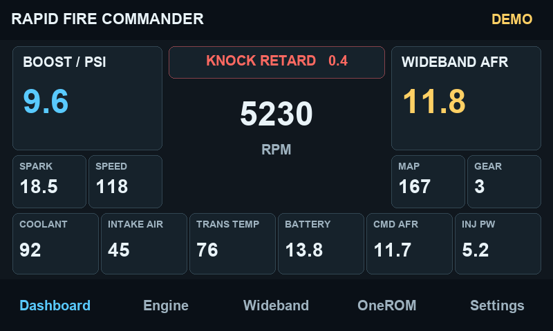

# Rapid Fire Commander Wi-Fi

[Download the complete printable Wi-Fi handbook (PDF)](Rapid-Fire-Commander-WiFi-Booklet.pdf). Print the A5 pages in Booklet mode on double-sided A4 with left binding.

Commander Wi-Fi connects TunerPro RT on a Windows laptop to OneROM through the Guition ESP32-P4 dashboard. The Wi-Fi edition targets the 4.3-inch Guition JC4880P443C_I_W/Y with 16 MB flash and ESP32-P4 silicon revisions 0.1 through 1.99.

The dashboard also includes a FAT32 SD Tune Selector for up to 64 compatible BIN files, USB SD Card Access, and on-screen wideband display. The guides below cover the hardware and menus in more detail.

- [Commander menu and feature guide](HELP.md) covers OneROM, SD tunes, settings and GT Pro logging, with screenshots and a Wi-Fi connection diagram.
- [Windows flashing and recovery](WINDOWS.md) covers board identification, BOOT mode, backups and using Espressif Flash Download Tool with the Wi-Fi kit.
- [Wideband wiring and setup](WIDEBAND.md) covers the Expand IO pinout and the Innovate LM-2 and AEM options.

The Wi-Fi firmware and Windows kit are distributed privately. This repository contains the documentation and printable booklet.

For a Delco 808 wired directly to OneROM, select **ALDL 808 DT** in the Rapid Fire OneROM app. If you use GT Pro for logging, select its separate acquisition COM port and the matching ADX in TunerPro RT. See the [Commander help guide](HELP.md) for setup.

| OneROM firmware mode | Use |
| --- | --- |
| **NORMAL DT** | Honda standard Ostrich with Display Trace. The optional UART runs at 38,400 baud. |
| **ALDL 808 DT** | Delco 808 wired directly to OneROM for ALDL at 8,192 baud, with default signal polarity. |

## Dashboard and Engine

Open **Settings → Demo mode** to preview all gauges. Live mode starts by default. The Engine tab offers **Auto**, **11P** and **12P**. Auto follows a supported tune family after verified SD load. Select the exact ADX and MAP range in TunerPro RT.

## Connect the laptop

1. With the Wi-Fi build already installed, connect OneROM to the P4’s **USB2** port and power the P4 through **USB3**.
2. On the P4, open **OneROM → TunerPro bridge** for emulation, or **OneROM → TunerPro + GT Pro** to include Holden ALDL logging. Wait for **OneROM ready on USB2**.
3. In Windows, join the network shown on the P4’s **Commander Wi-Fi** screen using the password displayed there.
4. Open the Commander Wi-Fi Windows app and select **Connect**.
5. In TunerPro RT, select the COM port mapped to the OneROM endpoint. For logging, select the GT Pro under **Settings → OBDX devices** on the P4, choose the separate acquisition COM port in TunerPro RT, and load the ADX that matches the ECU and calibration.

| TunerPro RT function | Local endpoint for the Windows COM mapping |
| --- | --- |
| OneROM emulation | `127.0.0.1:22170` |
| GT Pro ALDL acquisition | `127.0.0.1:22171` |

The Windows app presents these as local RFC 2217 endpoints. Use the COM numbers assigned by your Windows serial port provider in TunerPro RT. The Commander Wi-Fi app has no trial timer.

## Bench results

On the owner’s Windows laptop, Commander connected over Wi-Fi and TunerPro RT detected OneROM. The owner reported a successful BIN download and upload with no errors. The matching ADX loaded in TunerPro RT. Live GT Pro telemetry with an ECU connected remains to be verified on the Wi-Fi build.

## Troubleshooting

- **Peer disconnected** can occur when the P4 is waiting for OneROM. Check that OneROM is on **USB2** and wait for **OneROM ready on USB2** before selecting **Connect** in the app.
- If a fresh session is needed, close TunerPro RT, disconnect the Windows app and restart the P4. Select the bridge mode again and reconnect the laptop to the dashboard’s Wi-Fi.
- For the wired release and its printable handbook, see the [Commander README](https://github.com/RapidFire-001/rapid-fire-commander).

## Copyright

Copyright © 2026 Rapid Fire (RapidFire-001). All rights reserved in the original Rapid Fire Commander Wi-Fi firmware, Windows app, documentation and illustrations.

The Wi-Fi firmware and Windows kit are distributed privately. For permission to redistribute Rapid Fire materials, contact [Rapid Fire Software](mailto:support@rapidfiresoftware.net). Third-party products and materials are credited in the relevant guides.
