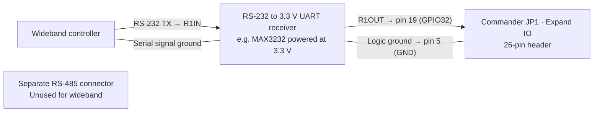

# Wideband wiring for Commander Wi-Fi

Commander receives a digital wideband signal on **P4 UART2 RX, GPIO32**. Use one supported source at a time. The screen shows AFR and lambda when valid data arrives.

## Find the wideband input on the display board

On the Guition **JC4880P443C_I_W** schematic, **JP1** is the 2×13 header labeled **Expand IO**. Look for **GPIO32** at JP1 pin 19 and **GND** at pin 5. The schematic shows pin 20 beside pin 19 as **C6_U0RXD**. That pin belongs to the ESP32-C6. The separate RS-485 connector uses different signals. Match the board model and pin-1 orientation to the drawing before wiring. [Guition Expand IO schematic](https://github.com/ultramcu/guition-jc4880p443c-i-w/blob/master/schematic/03-expand-io_usb-fs-hs_lcd-backlight.webp)

## Required serial interface

Use a **true RS-232 to 3.3 V UART receiver**, for example a MAX3232 breakout designed for 3.3 V operation and powered at 3.3 V. Check the breakout pinout for its RS-232 receive input and its 3.3 V logic receive output. Keep raw RS-232 voltages, 5 V logic, vehicle power, CAN and analog outputs away from the P4 GPIO. A USB-to-TTL cable alone does not convert RS-232 signal levels. [MAX3232 reference](https://www.ti.com/product/MAX3232)

| From | To |
|---|---|
| Wideband RS-232 TX | Receiver RS-232 input, often labeled R1IN |
| Receiver 3.3 V logic output, often labeled R1OUT | Guition JP1 pin 19, P4 GPIO32 |
| Receiver logic ground | Guition JP1 pin 5, GND |
| Wideband serial signal ground | Receiver RS-232 signal ground, according to the controller and receiver pinouts |

The P4 connection is receive-only. Leave adapter transmit wiring to the wideband unused. Power the module from a suitable regulated 3.3 V source as specified by the module. Check the JP1 orientation and actual board revision with power off. [Guition board specifications](https://www.guition.com/icms/upload/fb081940d6fc11f09850077a33e1404f/file/productmanager-productfile/5dfbe9a7c0fc44869270528bd2411b1e/Directory/JC4880P443C_I_W%20Specifications-EN-V1.0_1776241869964.pdf)

## Choose the source

| Controller | Signal | Commander setting |
|---|---|---|
| Innovate LM-2 | MTS Serial OUT. Use the matching MTS serial-out lead for the LM-2 connector and verify its TX and ground pinout. | **Wideband → Source: LM-2**. The firmware listens at 19,200 baud, 8N1 and uses the first channel. |
| AEM X-Series 30-0300 | Blue RS-232 Serial OUT wire. Set the gauge to AFR display mode. | **Wideband → Source: AEM**. The firmware listens at 9,600 baud, 8N1 and derives lambda using a gasoline reference of 14.65. |

Compare the P4 reading to the controller display on the bench. Dashes indicate unavailable input or invalid readings. The dashboard returns to LM-2 after a reboot. This feature displays readings on the P4. TunerPro wideband passthrough remains pending, and both sources still need physical verification on this build. [Innovate LM-2 manual](https://www.innovatemotorsports.com/wp/content/uploads/2022/05/LM2_Manual.pdf) · [AEM 30-0300 manual](https://documents.aemelectronics.com/techlibrary_30-0300.pdf)
