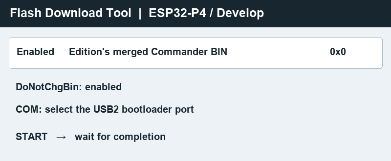

# Flash Commander on Windows

## Choose the package and check the board

Use the Wired or Wi-Fi package for your device. Both target the Guition JC4880P443C_I_W/Y 4.3-inch ESP32-P4 display with 16 MB flash and P4 silicon revisions v0.1 through v1.99. Verify the board label and revision before flashing. Disconnect OneROM and vehicle wiring.

The merged BIN replaces the P4 flash, including saved settings. Back up the existing firmware before updating if you need a recovery image. The Wi-Fi package updates the P4 and relies on the existing wireless coprocessor firmware.

## Flash with Espressif Flash Download Tool

1. Extract the entire release ZIP. Verify the merged BIN against the supplied SHA-256 checksum with PowerShell's **Get-FileHash**.
2. Open Windows Device Manager and expand **Ports (COM & LPT)**. With the board unpowered, hold **BOOT**, connect a data-capable cable to **USB2**, and release BOOT when the new COM port appears.
3. Open **Flash Download Tool**. If it is absent from your kit, download it from [Espressif](https://www.espressif.com/en/support/download/other-tools). Choose **ESP32-P4** and **Develop**.
4. Select the edition's merged BIN on a single enabled row at **0x0**. Clear other rows and enable **DoNotChgBin**. Select the USB2 bootloader COM port.
5. Click **START** and keep the USB cable connected until the tool reports completion. Reconnect power with BOOT released to start Commander.
6. Check the Dashboard and Engine tab. Turn on **Settings → Demo mode** to check gauge formatting and turn it off again for live use.

See the [ESP32-P4 Flash Download Tool guide](https://docs.espressif.com/projects/esp-test-tools/en/latest/esp32p4/production_stage/tools/flash_download_tool.html) for the tool screens.

## Connect after flashing

| Edition | Connection |
| --- | --- |
| Wired | Connect Windows to **USB3** for the TunerPro bridge or SD Card Access. In normal operation **USB2** hosts OneROM. |
| Wi-Fi | Connect Windows to the Commander network and start the bundled Windows Companion launcher. Map the local RFC 2217 endpoints to COM ports with your Windows virtual serial port provider. Use its OneROM mapping at **127.0.0.1:22170** and the separate GT Pro mapping at **127.0.0.1:22171** when enabled. Use USB2 for P4 flashing. |

## Troubleshooting

| Symptom | Check |
| --- | --- |
| No new bootloader COM port | Try a known data cable directly to Windows, check USB2 and repeat the BOOT sequence. |
| COM port busy or unable to connect | Close TunerPro and serial monitors. Recheck the bootloader port in Device Manager. |
| Flash fails | Verify the edition and checksum, check power and the cable, then retry in bootloader mode. |
| Blank screen after flashing | Boot with BOOT released. Verify the board model and flash size before retrying. |
| No live ECU readings | Verify the matching ADX in TunerPro RT and check the acquisition connection. The Engine family selector identifies a profile, while TunerPro decodes the ECU data. |
